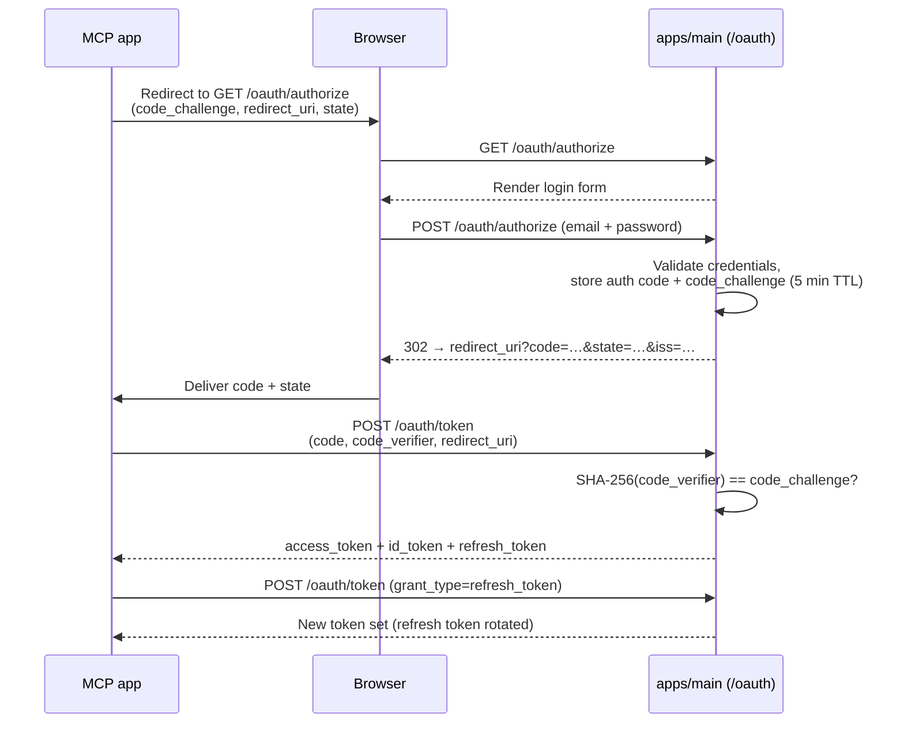

# oauth

OAuth 2.0 authorization server module for `apps/main`.

Allows the MCP app to authenticate users through a standard browser-based flow rather than requiring them to share API tokens directly. Implements authorization code + PKCE so the flow is safe for public clients. Tokens are RSA-signed so the MCP app can verify them offline via the JWKS endpoint without round-tripping to the auth server.

This module owns third-party delegation end to end: client registration, the user's grants, authorization codes, and the `.well-known` protocol metadata. It signs nothing itself — tokens come from `tokens` — and it knows nothing about first-party sessions, which are `auth`.

## Client registration

A `client_id` reaches this server one of three ways, and `OAuthClientService.resolveByClientId`
decides which without the caller having to care:

- **First party.** `first-party-clients.ts` names the clients this project ships, upserted at boot.
- **Client ID Metadata Document.** An https `client_id` URL with a path component is fetched, and
  the document it returns is validated against the same metadata rules a registration request goes
  through, plus the requirement that its `client_id` equals the URL it came from. Redirects are
  refused, since a redirect would break that equality. The result is cached for as long as the
  origin's `Cache-Control` asks, clamped to between five minutes and a day, and a document that
  later stops resolving falls back to the last good copy rather than revoking consent the user has
  already given.
- **Dynamic client registration.** `POST /.well-known/oauth-client`, kept for clients that predate
  metadata documents. Deprecated by MCP in its 2026-07-28 revision.

`GET /.well-known/oauth-authorization-server` advertises the middle option through
`client_id_metadata_document_supported`, which is how a client knows it need not register at all.

## Verification

`ClientTrustService` decides whether this server vouches for a client's identity, and the consent
screen and Authorized Apps page render that decision. A first-party client is verified. A metadata
document is verified when its `client_id` is listed in `CIMD_TRUSTED_CLIENT_IDS`, since serving that
document is a claim backed by control of the URL. Nothing else is: a dynamic registration proves
only that someone can post to a public endpoint.

Entries are whole `client_id` URLs, compared exactly. A client that moves its document loses the
badge until an operator updates the list, which is a visible warning rather than a failed
authorization. Trusting a host instead would vouch for every document it serves: `claude.ai` hosts
both Claude's metadata document and published Artifacts, and a host cannot tell them apart.

The trust list gates display, not access. An unlisted client still authorizes; its consent screen
carries the unverified-app warning naming the hosts the user is about to be sent to. Verification is
evaluated per read, so editing the list takes effect without waiting for cached documents to expire.

## Client logos

A registrant's `logo_uri` is never handed to a browser. The URI is fetched once, at registration,
by `AssetFetcher` from `@ctm/server-utility`, which admits only https and only hosts that resolve
entirely to public addresses, and re-checks each redirect hop. `logo-image.ts` then refuses
anything that is not a decodable image within the dimension cap and re-encodes it to a fixed-size
PNG. The stored copy is served from `GET /oauth/clients/:clientId/logo`, and
`AuthorizedAppDto.logoPath` points there. A logo that fails any of this is dropped and the client
registers without one.

## Authorization code flow

