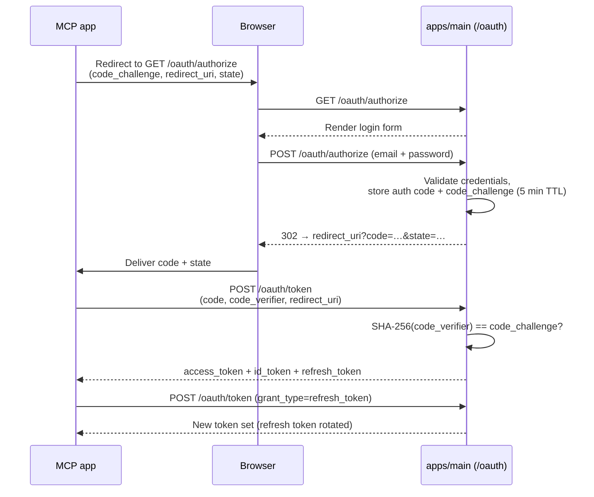

# oauth

OAuth 2.0 authorization server module for `apps/main`.

Allows the MCP app to authenticate users through a standard browser-based flow rather than requiring them to share API tokens directly. Implements authorization code + PKCE so the flow is safe for public clients. Tokens are RSA-signed so the MCP app can verify them offline via the JWKS endpoint without round-tripping to the auth server.

This module owns third-party delegation end to end: client registration, the user's grants, authorization codes, and the `.well-known` protocol metadata. It signs nothing itself — tokens come from `tokens` — and it knows nothing about first-party sessions, which are `auth`.

## Client logos

A registrant's `logo_uri` is never handed to a browser. The URI is fetched once, at registration,
by `AssetFetcher` from `@ctm/server-utility`, which admits only https and only hosts that resolve
entirely to public addresses, and re-checks each redirect hop. `logo-image.ts` then refuses
anything that is not a decodable image within the dimension cap and re-encodes it to a fixed-size
PNG. The stored copy is served from `GET /oauth/clients/:clientId/logo`, and
`AuthorizedAppDto.logoPath` points there. A logo that fails any of this is dropped and the client
registers without one.

## Authorization code flow

