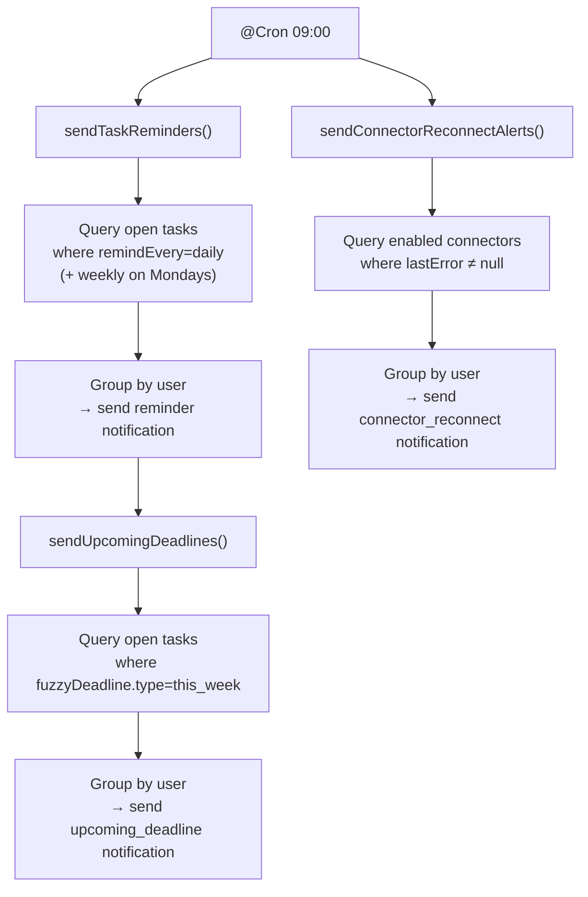

# reminders

Scheduled reminder module for `apps/main`.

## Responsibilities

- **Task reminders** — surfaces tasks the user has flagged for recurring attention (daily or weekly), so they're not buried in the full task list.
- **Upcoming deadlines** — proactively alerts users to tasks due this week, even if they haven't set an explicit reminder.
- **Connector reconnect** — notifies users when a connector has a persistent error so broken syncs don't go unnoticed.

The cron runs daily at 09:00. `getSurfacedTaskIds` is also used by `TasksService` to support filtering by `surfaced=true`.

## Daily cron flow

